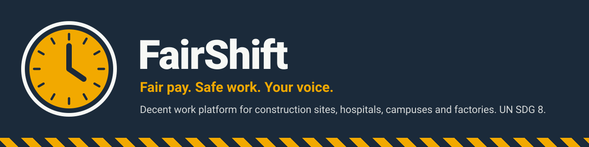
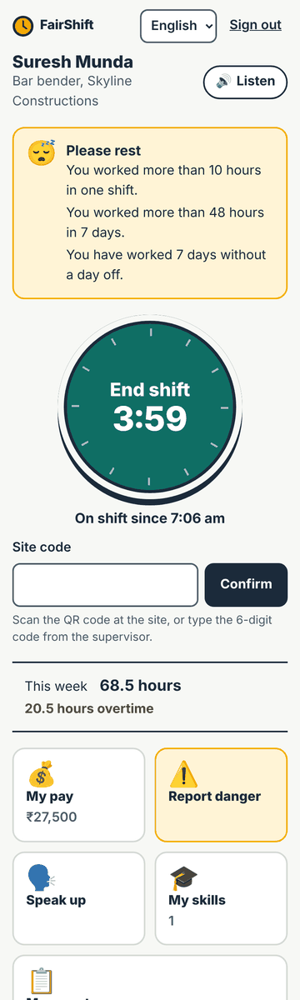
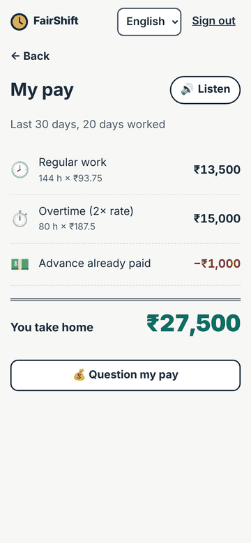
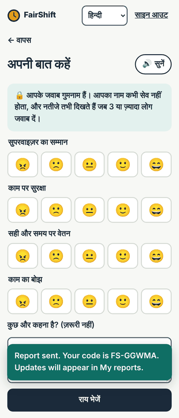
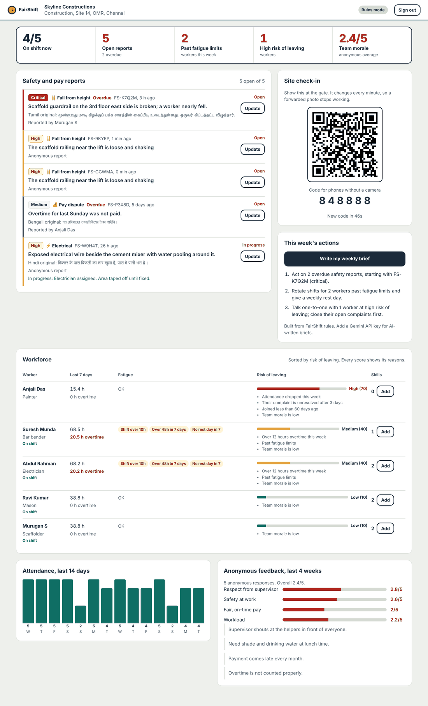
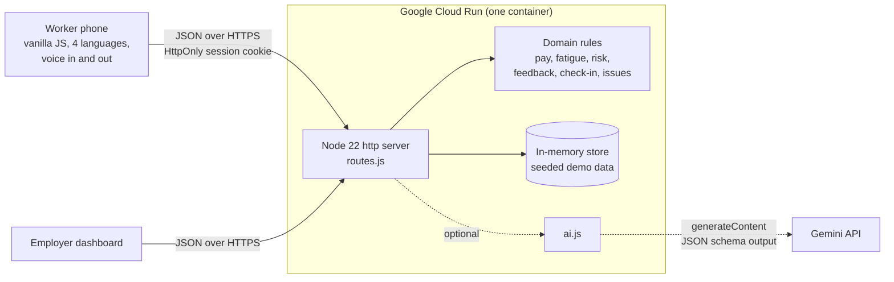

<p align="center">
  
</p>

<p align="center">
  <a href="https://YOUR-CLOUD-RUN-URL"></a>
  
</p>

<p align="center">
  
  
  
  
  
  
</p>

**FairShift** gives shift workers on construction sites, in hospitals and on college campuses a clear view of their hours and pay, a safe way to report danger, and an anonymous voice. It gives employers early warning of fatigue, unsafe sites and people about to quit. Built for **Prompt Wars 2026 × SRM ACM Student Chapter**, problem statement *FairShift: Decent Work Platform*.

> **Try it in 10 seconds:** open the live demo and tap a demo account. Worker PIN `1234`, employer password `demo1234`.

| Worker app (phone) | Payslip | Anonymous voice, in Hindi |
| :---: | :---: | :---: |
|  |  |  |



---

## The problem, and what FairShift does about it

| Worker pain point | FairShift feature | How it works |
| --- | --- | --- |
| Opaque pay, uncounted overtime | **Shift tracking + clear payslips** | Check in by scanning a rotating site QR (or typing its 6-digit code). Overtime is computed automatically under Indian norms (beyond 8h/day **or** 48h/week, paid at 2×). Every payslip line shows *hours × rate* so it can be checked by hand, and is read aloud in the worker's language. One tap turns a doubt into a pay query. |
| Fear of being identified | **Honest, anonymous feedback** | Four questions answered with faces. Names are never stored with answers; results stay hidden until 3+ people respond; entries are inserted at random positions so order cannot link them to who submitted. |
| Hazards ignored until someone is hurt | **Voice or text safety reports with status tracking** | Pick a hazard icon, speak in your own language (browser speech recognition) or type. Gemini triages severity and writes an English summary for the office; rules take over if AI is off. Critical reports unanswered for 2 hours are flagged overdue. Anonymous reporters track status with a code kept only on their phone. |
| Skills lost between jobs | **Portable skill passport** | Employers verify training; workers share a signed link (WhatsApp, any browser) showing verified skills, days and hours. No phone number is exposed. |
| Overwork | **Fatigue alerts** | Flags shifts over 10h, more than 48h in 7 days, under 11h rest, or 7 days without a day off. Shown to the worker as a calm warning and to the employer as a chip. |
| Employers can't see trouble coming | **Admin dashboard with explainable quit risk** | Attendance trend, report queue sorted by urgency, live check-in QR, workforce table with a 0-100 risk score that always lists its reasons (attendance drop, ignored complaint, heavy overtime, fatigue, new joiner, low morale). A one-click weekly brief turns the numbers into three actions. |
| Regional languages, low literacy, basic phones | **Voice and local, everywhere** | English, Hindi, Tamil and Bengali. Every screen has a *Listen* button (phone's built-in voice). Big icons, faces instead of scales, 48px touch targets. No framework, no web fonts: the whole worker app (HTML, CSS, JS, four languages) is about 21 KB gzipped and loads on 2G. |

All 8 example features from the brief are implemented and working, plus the two required interfaces (worker and employer).

## One platform, many workplaces

A **sector profile** changes only what has to change (the hazards a worker can report); pay, fatigue, feedback and passports work the same everywhere. The demo ships three live organisations.

| | Construction site | Hospital | College campus | Factory (profile included) |
| --- | --- | --- | --- | --- |
| Demo org | Skyline Constructions, Chennai | CityCare Hospital | Greenfield College | add an organisation in `src/store.js` |
| Typical worker | Daily-wage mason, migrant bar bender | Sanitation staff, ward assistant, guard | Housekeeping, electrician, gardener | Line operator |
| Hazards offered | Fall, electrical, machinery, heat, fire | Needle injury, infectious waste, violence, chemicals, slippery floor | Electrical, slippery floor, fire, chemicals | Machinery, chemicals, noise, fire |
| Check-in point | QR at the site gate | QR at the ward station | QR at the facilities office | QR at the shop-floor entrance |
| Pay model | Daily wage, weekly overtime, advances | Monthly with PF and ESI | Monthly with PF and ESI | Shift wage with overtime |

## How it works



- **Rules first, AI second.** Every decision that affects pay or safety is deterministic and unit-tested. Gemini adds triage, translation of supervisor notes into the worker's language, and weekly briefs. If the key is missing, the model errors or times out, the app falls back to rules and keeps working.
- **One request per screen.** The worker home screen arrives in a single API call, which matters on a weak 2G signal.
- **Zero frontend dependencies, one backend dependency** (`qrcode`, for the check-in QR). Everything else is the Node standard library and native browser features: `BarcodeDetector` for in-app QR scanning, `SpeechRecognition` and `speechSynthesis` for voice, `<dialog>` for modals.

## Security and privacy

- **No secrets in the repo.** `SESSION_SECRET` and `GEMINI_API_KEY` come from the environment (`.env.example` lists them).
- **PINs and passwords** are salted `scrypt` hashes, checked with constant-time comparison, with a 5-attempt lockout and timing equalised for unknown accounts.
- **Sessions** are HMAC-signed, `HttpOnly`, `SameSite=Strict`, `Secure` on HTTPS, and expire after 12 hours.
- **CSRF**: state-changing requests must be `application/json` and same-site.
- **Strict CSP** (`default-src 'self'`, no inline script or style), `nosniff`, `no-referrer`, HSTS, `frame-ancestors 'none'`.
- **XSS-safe rendering**: the UI builds DOM nodes with `textContent`; user text is never parsed as HTML.
- **Input limits** on every field, 16 KB body cap, path traversal blocked for static files.
- **Role and org isolation**: workers cannot call employer APIs; employers can only see and change their own organisation.
- **Anti-proxy attendance**: check-in tokens are HMAC-signed per site and expire within about 3 minutes, so a forwarded photo of the QR stops working.
- **Prompt-injection resistant AI**: worker text is passed as quoted data, the model must answer in a fixed JSON schema, outputs are validated against enums, and AI can never lower a rule-based severity. Only aggregate, nameless numbers go into the weekly brief.

## Accessibility

Semantic HTML with real `<button>`, `<fieldset>`/`<legend>` and labelled inputs; skip link; visible focus rings; full keyboard use (radio-based hazard and face pickers work with arrow keys); `aria-live` toasts; screen-reader text for charts; colour contrast at WCAG AA or better; `prefers-reduced-motion` respected; `lang` attribute follows the chosen language so screen readers pronounce Hindi, Tamil and Bengali correctly.

## Testing

```bash
npm test
```

49 tests with the built-in `node:test` runner, no test framework needed:

- `pay.test.js`: daily vs weekly overtime, PF/ESI, ESI wage ceiling, payslip arithmetic
- `fatigue.test.js`: long shifts, weekly limit, short rest, lunch breaks, streaks, open shifts
- `risk.test.js`: explainable quit-risk scoring, anonymous reports never count against a named worker
- `feedback.test.js`: anonymity threshold hides scores and comments
- `checkin.test.js`: QR token expiry, tampering, wrong site, wrong secret, 6-digit codes
- `issues.test.js`: multilingual triage, critical escalation, SLA overdue, queue order
- `i18n.test.js`: every key translated in every language with matching placeholders
- `ai.test.js`: Gemini calls against a fake API: key sent in a header not the URL, schema-constrained output, injected or malformed answers discarded, offline fallback
- `api.test.js`: end-to-end over HTTP: auth, lockout, roles, org isolation, check-in, anonymous reporting, feedback privacy, validation, security headers, gzip, path traversal

## Run locally

```bash
npm install
SESSION_SECRET=any-long-random-string npm start
# open http://localhost:8080
```

Add `GEMINI_API_KEY=...` (from Google AI Studio) to switch on AI triage, translation and briefs.

## Deploy to Google Cloud Run

From Google Cloud Shell, in the project folder:

```bash
gcloud services enable run.googleapis.com cloudbuild.googleapis.com artifactregistry.googleapis.com
gcloud run deploy fairshift --source . --region asia-south1 --allow-unauthenticated \
  --max-instances 1 --memory 256Mi \
  --set-env-vars SESSION_SECRET=$(openssl rand -hex 32),GEMINI_API_KEY=YOUR_KEY
```

`--max-instances 1` keeps the in-memory demo data consistent. For production, store the key in Secret Manager (`--set-secrets GEMINI_API_KEY=gemini-api-key:latest`) and move the store to Firestore.

## Project structure

```
src/
  server.js        HTTP server, security headers, static files, auth gate
  routes.js        API handlers and the route table
  security.js      hashing, signed sessions, login lockout
  store.js         in-memory data with realistic seeded demo data
  ai.js            optional Gemini layer with strict fallbacks
  domain/          pure, unit-tested rules
    pay.js  fatigue.js  risk.js  feedback.js  checkin.js  issues.js  sectors.js  time.js
public/
  index.html  worker.html  admin.html  passport.html
  css/app.css
  js/common.js  i18n.js  login.js  worker.js  admin.js  passport.js
test/              node:test suites
```

## SDG 8 alignment

- **Target 8.5** (decent work and equal pay for work of equal value): transparent, checkable payslips and automatic statutory overtime.
- **Target 8.8** (protect labour rights and safe working environments for all workers, including migrants): safety reporting with escalation, fatigue limits, anonymous voice, and interfaces in workers' own languages.
- **Economic growth**: portable skill passports let experience count at the next job, and employers cut attrition by acting on early, explainable signals.

## What's next

IVR and missed-call reporting for feature phones, offline queueing for sites with no signal, Firestore persistence, UPI wage-payment proof on payslips, and more languages (each is one block in `public/js/i18n.js`).
